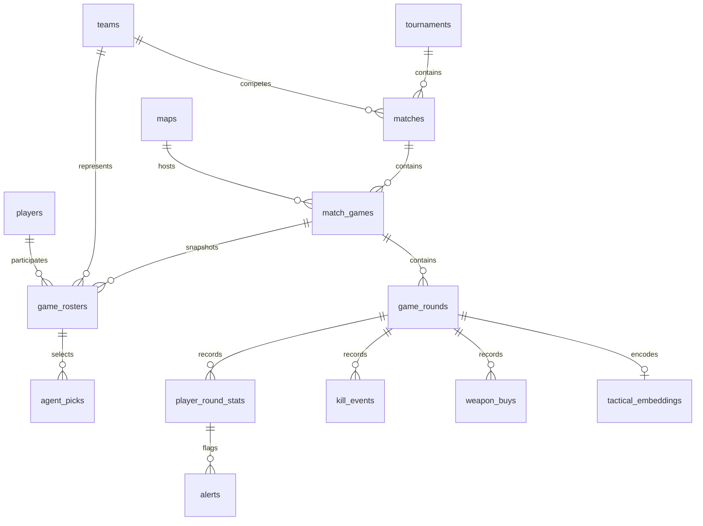

# Database design and demonstration

`users` controls application authorization independently of the match graph. Role strings are `Head_Coach` and `Scout_Analyst`. Historical rosters avoid making old games change when current team membership changes. Roster and round triggers validate participating teams; composite foreign keys ensure telemetry belongs to the correct game and participant. Referential constraints reject orphan data. Updates to historical facts should be done as a deliberate administrative data correction; the current app exposes team creation and current roster updates only.

## Advanced features to demonstrate

1. `CALL sp_predict_win_probability(1,19500,19500,NULL,NULL)`: map-scoped historical estimate with ±2,500 credit matching and Laplace smoothing. Requires five observed player spends per side. This is a descriptive baseline, not an ML model.
2. Insert an unusually high damage observation after at least ten variable baseline observations: `stats_anomaly` writes an alert. `pnpm db:test` demonstrates this inside a rolled-back transaction. The baseline is the player's previously ingested observations in the same tournament; updates do not regenerate alerts. Chronological imports are recommended.
3. Query `mv_player_leaderboards`: five domain tables plus independent headshot aggregation avoid join multiplication. Refresh after imports; it is not continuously live. ACS uses observed combat score / observed rounds and ADR uses damage / observed rounds. Event headshot kill rate has a separate denominator.
4. Cosine nearest neighbors: `profile <=> reference_profile` ordered ascending; display `1-distance` as similarity. Exact scans are appropriate for fixtures. Optional IVFFlat is provisioned separately after data loading.
5. Composite unique B-tree indexes support match-game numbering and game-round numbering. Additional indexes support tournament dates, player rounds and round events. Index columns live on their own table.

## Feature version vtac-v1

| Dimensions | Meaning |
|---|---|
| 0–7 | Bias, aggregate spend, minimum spend, maximum spend, damage, event count, located event count, agent count |
| 8–15 | Damage histogram in 100-damage bins (last bin capped) |
| 16–79 | 8×8 normalized spatial event histogram |
| 80–95 | Ten-second event time histogram (last bin capped) |
| 96–111 | Weapon-name hash histogram |
| 112–127 | Agent-name hash histogram |

Numeric scaling is part of the versioned contract. Encoder changes require a new feature version and re-embedding; never compare versions. Roles are stored relationally, while agent names provide composition features in v1. The encoder contains no attack/defense orientation, player tracks, ability usage or learned semantics. Missing spatial data changes the meaning of similarity, so review telemetry coverage before drawing conclusions.

## Security boundary

The deployed connection is `vtac_app`, not the database owner. It cannot create/drop schema objects or change users. It has read privileges, team/player writes and scouting-note inserts needed by the current UI. The server authenticates signed cookie subjects and reloads the user's current role, then rejects every coach action for scouts. This application login is a trusted backend credential, not an SQL account issued to individual scouts. Do not distribute it or provide arbitrary SQL endpoints. Admin imports and user management use a separate local connection.

## Public-data extensions

`data_sources` separates real and synthetic match cohorts. `data_imports` stores fingerprint/selection/counts and is linked from imported matches. `source_key` records upstream identity without replacing local primary keys. `map_coverage` records source block flags and expected versus observed rounds. `player_game_stats` preserves published map-level values, while `team_round_economy` stores nullable equipment value and bank independently of individual credits spent. Its trigger rejects teams outside the match. `scouting_notes` records coach observations and authorship.

The adapter never expands a map-level ACS into artificial per-round combat scores. The original materialized leaderboard continues serving observed fixture player-round rows; public player summaries weight available published map averages by rounds. Missing statistics are excluded from their own denominators. Public aggregate headshot percentage is withheld without source hit denominators. The separate `vtac-economy-v1` feature contract is documented in [DATASETS.md](DATASETS.md).

Sessions expire after eight hours. Removing a user or changing their role takes effect on their next request. There is no per-session logout revocation list; logout clears the browser cookie. Password-reset workflows, shared rate limiting and production deployment are future work.
